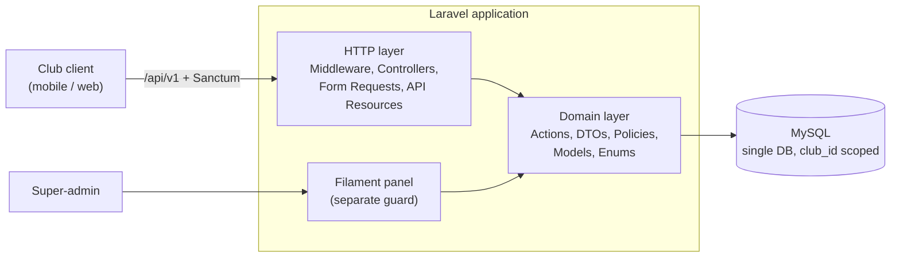

# RYADA

Multi-tenant SaaS for managing karate clubs and tournaments.

> **Status:** under active development. See the [roadmap](../../issues) (milestones M1 to M7) for progress.

## What it does

- **Clubs (tenants):** each club manages its own players, staff, training groups, memberships, and payments.
- **Tournaments:** registration rules, kumite bracket generation, kata scoring, results, and certificates.
- **Platform admin:** the platform owner manages clubs, SaaS plans, and subscriptions from a Filament panel.
- **Bilingual:** Arabic and English across API messages and the admin panel.

## Tech stack

Laravel, MySQL, REST API (`/api/v1`), Sanctum, Pest, Pint, Larastan, Filament (admin). Redis and Reverb are introduced only where needed (Milestone 6).

## Architecture



Request flow on the club API: `SetLocale` and tenant resolution middleware run first, then a thin Controller validates with a Form Request, builds a DTO, calls an Action, and returns an API Resource. Authorization is handled by Policies.

## Project structure

```text
app/
  Domain/
    <Domain>/            # Club, Player, Tournament, ...
      Actions/
      DTOs/
      Enums/
      Models/
      Policies/
    Shared/              # cross-domain pieces (e.g. BelongsToClub)
  Http/
    Controllers/Api/V1/
    Requests/
    Resources/
docs/adr/                # architecture decision records
```

Conventions:

- Business logic lives in Action classes that take DTOs; multi-step operations use `DB::transaction`.
- Controllers stay thin. The domain layer never depends on `App\Http` (enforced by an architecture test).
- Every user-facing string is a translation key present in both `en` and `ar`.
- Every issue is a branch + pull request with Conventional Commits (`feat(player): ...`).

## Roles & permissions

RBAC uses `spatie/laravel-permission` in Teams mode, with the club as the team. Each club has its own `owner`, `coach`, `staff` and `referee` roles, created at registration by `SyncClubRolesAction`. Policies check both the club and the permission. See [ADR-004](docs/adr/004-roles-and-permissions.md).

- Authorize against the model (`$this->authorize('update', $club)`), never against a bare permission string such as `can('club.update')`, because that skips the club check.
- Token abilities (`read` / `write`) only cap what a token can do. Real permissions come from roles and policies.

## Localization

The API speaks Arabic and English. See [ADR-003](docs/adr/003-localization.md).

- Locale is resolved from the `Accept-Language` header, then `users.locale`, then the default (`en`). Clients should always send the user's chosen language in `Accept-Language`.
- Errors have a stable `code` and a translated `message`. Branch on `code`, not `message`.
- Rule: never hardcode user-facing strings. Add the key to both `lang/en` and `lang/ar`; CI checks that they match.

## Architecture decisions

- [ADR-001: Tenancy strategy](docs/adr/001-tenancy-strategy.md)
- [ADR-002: Project structure](docs/adr/002-project-structure.md)
- [ADR-003: Localization](docs/adr/003-localization.md)
- [ADR-004: Roles and permissions](docs/adr/004-roles-and-permissions.md)

## Getting started

Requirements: PHP 8.4, Composer, MySQL 8.

```bash
git clone https://github.com/MahmoudNagah999/RYADA.git
cd RYADA
composer install
cp .env.example .env
php artisan key:generate
# set DB_* values in .env, then:
php artisan migrate
```

## Quality checks

```bash
composer lint      # Pint
composer analyse   # Larastan
composer check     # lint + analyse + tests
php artisan test   # Pest
```
